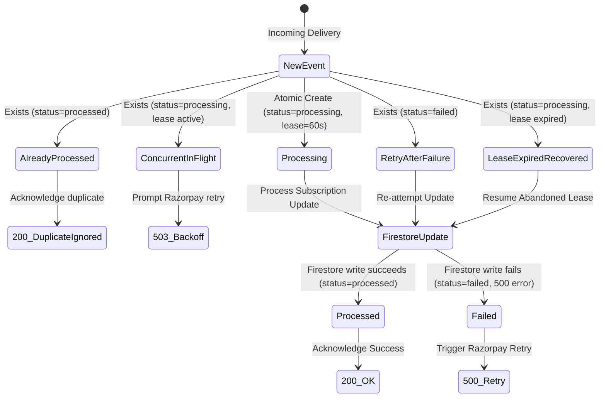

# FIRESTORE SUBSCRIPTION SCHEMA & ENTITLEMENTS LEDGER
**Document ID:** FS-SUBS-SCHEMA-2026
**Target Platform:** Google Cloud Firestore (Primary Application Platform)
**Status:** Approved & Enforced

---

## 1. Primary Collection: `user_subscriptions/{userId}`

Firestore `user_subscriptions` is the **single authoritative source of truth** for student subscription status and feature entitlements across the application.

### Document Path
`/databases/(default)/documents/user_subscriptions/{userId}`
*Note: `{userId}` is the student's immutable Firebase Authentication UID.*

### Field Specifications

| Field Name | Firestore Type | Nullable | Description / Value Constraints |
|---|---|---|---|
| `user_id` | `string` | No | Firebase Auth UID (matches document ID). |
| `provider` | `string` | No | Always `'razorpay'`. |
| `plan_tier` | `string` | No | `'free' \| 'pro' \| 'cohort'`. |
| `status` | `string` | No | `'free' \| 'active' \| 'authenticated' \| 'trialing' \| 'past_due' \| 'halted' \| 'pending' \| 'cancelled'`. |
| `order_id` | `string` | Yes | Razorpay Order ID (`order_...`) for one-time payments. |
| `payment_id` | `string` | Yes | Razorpay Payment ID (`pay_...`) of the latest verified transaction. |
| `subscription_id` | `string` | Yes | Razorpay Subscription ID (`sub_...`) for recurring auto-debit mandates. |
| `billing_interval` | `string` | Yes | `'month' \| 'year' \| 'one_time' \| 'forever'`. |
| `current_period_start` | `string` (ISO 8601) | Yes | Timestamp when the active billing cycle began. |
| `current_period_end` | `string` (ISO 8601) | Yes | Expiration timestamp of the current active cycle. |
| `cancel_at_period_end` | `boolean` | No | `true` if student cancelled renewal; remains active until `current_period_end`. |
| `latest_event_created` | `integer` (Unix sec) | Yes | Unix timestamp of the latest processed Razorpay webhook event. Enforces monotonic ordering. |
| `last_verified_payment`| `string` | Yes | Payment ID confirmed by cryptographic verification. |
| `updated_at` | `string` (ISO 8601) | No | Server timestamp of last document modification. |

---

## 2. Security Rules Enforcement

In `firestore.rules`:
```javascript
match /user_subscriptions/{userId} {
  // Students can read ONLY their own subscription document
  allow read: if signedIn() && request.auth.uid == userId;

  // STRICT ZERO-CLIENT-TRUST INVARIANT:
  // All writes are rejected for client SDKs.
  // Updates MUST occur via server-side Supabase Edge Functions
  // using Google Service Account credentials.
  allow write: if false;
}
```

---

## 3. Webhook Idempotency Collection: `payment_webhook_events/{eventId}`

To guarantee that duplicate deliveries, retries, and concurrent webhook requests from Razorpay never corrupt student state or cause double-crediting, all incoming events are claimed atomically in Firestore.

### Document Path
`/databases/(default)/documents/payment_webhook_events/{eventId}`
*Note: `{eventId}` is derived from `x-razorpay-event-id` or `{eventType}_{entityId}`.*

### Field Specifications

| Field Name | Type | Description |
|---|---|---|
| `event_id` | `string` | Unique event ID. |
| `event_type` | `string` | Event name (e.g. `'payment.captured'`, `'subscription.activated'`). |
| `status` | `string` | `'processing' \| 'processed' \| 'failed'`. |
| `lease_expires_at` | `string` (ISO 8601) | Lease expiration (60 seconds after claim). Prevents crashed workers from locking events forever. |
| `attempt_count` | `integer` | Count of processing attempts (increments on retry). |
| `last_error` | `string` | Sanitized error message if prior attempt failed. |
| `created_at` | `string` (ISO 8601) | Timestamp of first receipt. |
| `updated_at` | `string` (ISO 8601) | Timestamp of last transition. |

---

## 4. Webhook Concurrency & Lease State Machine



---

## 5. Monotonic Ordering Defense

Network jitter can cause older webhook events to arrive after newer ones (e.g. an earlier `payment.failed` arriving after a later `payment.captured`).

**Protection Invariant:**
```ts
if (existingSub?.latestEventCreated && eventCreated < existingSub.latestEventCreated) {
  // Stale event detected!
  // Mark event processed to prevent infinite redelivery, but DO NOT modify subscription.
  return { status: 'stale_event_ignored' };
}
```
Older events can never overwrite or downgrade a newer subscription state.
