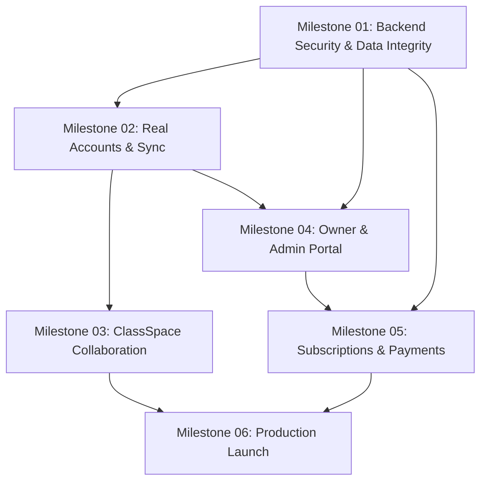

# Student Tracker — Engineering Project Roadmap
*Permanent Master Architecture & Milestone Tracking Roadmap*

---

## 1. Project Purpose & Current Architecture

### 1.1 Project Purpose
Student Tracker is a personal command center designed for university and college students, combining academic timetable tracking, attendance management, multi-mode focus sessions, syllabus coverage, spaced-repetition revision, gym logging, macronutrient tracking, and student collaboration. The core product philosophy is **offline-first reliability with optional zero-friction cloud synchronization**.

### 1.2 Technology Stack (Verified from Repository)
- **Frontend Framework:** React 19 (`^19.0.0`) with TypeScript (`^5.7.3`) and Vite (`^6.1.0`).
- **Styling & Design System:** Tailwind CSS v4 (`@tailwindcss/vite` `^4.3.3`) paired with custom CSS design tokens (`src/index.css`), supporting Light, Dark, and System theme modes with persistent terracotta/warm-editorial visual identity.
- **Iconography & Visual Elements:** Lucide React (`^1.16.0`), Tabler Icons (`^3.49.0`), Canvas Confetti, and Three.js.
- **Local Persistence Layer:** Offline-first local storage managed through `src/services/storage.ts` using storage key `tracker_app_data_v2`, backed by migration utilities (`src/services/migration.ts`) with automated data recovery, backup export (`.json` and `.ics`), and file-system import.
- **Backend & Cloud Infrastructure:**
  - Supabase client (`@supabase/supabase-js` `^2.118.0`) configured via environment variables (`VITE_SUPABASE_URL`, `VITE_SUPABASE_ANON_KEY`) in `src/services/authService.ts`.
  - Cloud synchronization service (`src/services/cloudSyncService.ts`) providing user data upsert to table `user_trackers` with client-side timestamp-based reconciliation (`mergeDatasets`).
  - Class collaboration backend (`src/services/classSpaceService.ts` and `supabase/migrations/20261022_classspace_schema.sql`) defining Postgres tables, Row Level Security (RLS) policies, and `SECURITY DEFINER` stored procedures.
- **Testing Architecture:** Vitest (`^3.0.5`) with React Testing Library (`^16.2.0`) and JSDOM (`^26.0.0`), running 30+ dedicated test suites under `tests/`.

### 1.3 Verified vs. Unverified Architecture Status
- `VERIFIED`: The offline-first application runs completely in-browser without requiring external services.
- `VERIFIED`: Fallback to offline operation is automatic when `VITE_SUPABASE_URL` and `VITE_SUPABASE_ANON_KEY` are unset or set to placeholder values.
- `VERIFIED`: Test suite isolates mock authentication fixtures strictly to `NODE_ENV === 'test'`.
- `UNVERIFIED`: Live Supabase backend connectivity, production database instances, and actual Google OAuth client credentials (live cloud integration is currently pending environment configuration).
- `UNVERIFIED`: Hosted serverless endpoints, remote payment processor webhooks, and production DNS/hosting deployment.

---

## 2. Six-Milestone Overview & Status Tracker

| Milestone | Title | Status | Prerequisites | Target Deliverable |
|---|---|---|---|---|
| **01** | [Backend Security & Data Integrity Audit](milestones/MILESTONE_01_BACKEND_SECURITY_DATA_INTEGRITY.md) | `COMPLETED_AND_VERIFIED` | None | Official `user_trackers` migration, user-scoped archive data preservation on sign-out, fetch error isolation, Owner ClassSpace permissions, corrupted storage sanitization, 324/324 passing tests |
| **02** | [Real Accounts & Cross-Device Sync](milestones/MILESTONE_02_AUTH_AND_CROSS_DEVICE_SYNC.md) | `COMPLETED_AND_AUDITED` (Hosted OAuth Pending Deployment) | Milestone 01 (Accepted) | Persistent capacity-based tombstones, in-flight race prevention, multi-account isolation, 339/339 passing tests |
| **03** | [ClassSpace Collaboration](milestones/MILESTONE_03_CLASSSPACE_COLLABORATION.md) | `COMPLETED_AND_AUDITED` (Hosted Realtime & DB Deployment Pending) | Milestones 01, 02 (Accepted) | Role permission matrix, member removal, collision-resistant join codes with rate limiting, shared timetable sync, isolated student attendance, forward migration `20261025_classspace_security_hardening.sql`, 360/360 passing tests |
| **04** | [Owner & Admin Portal](milestones/MILESTONE_04_OWNER_ADMIN_PORTAL.md) | `COMPLETED_AND_AUDITED` (Hosted Execution Pending Deployment) | Milestones 01, 02, 03 (Accepted) | Dedicated `/admin` route, server-verified roles (`admin_users`), `is_platform_operator` role boundary (support read-only), 403 access gate, paginated search, tamper-proof audit trail (`admin_audit_logs`), dual-step confirmation modal, 380/380 passing tests |
| **05** | [Subscriptions & Payments](milestones/MILESTONE_05_SUBSCRIPTIONS_AND_PAYMENTS.md) | `COMPLETED_AND_AUDITED` (Hosted Execution & Provider Secrets Pending Deployment) | Milestones 01, 04 (Accepted) | Server-authoritative entitlement engine, server-side Edge Functions (`supabase/functions/`), cryptographic HMAC-SHA256 signature verification with raw body, atomic conflict-safe idempotency ledger (`payment_webhook_events`), graceful past-due grace period, zero client-side secret exposure, 410/410 passing tests |
| **06** | [Production Launch & Reliability](milestones/MILESTONE_06_PRODUCTION_LAUNCH.md) | `AUDITED_READY_FOR_HOSTED_STAGING_DEPLOYMENT` (Hosted Deployment & Live OAuth Verification Pending) | Milestones 01–05 (Accepted) | Production readiness audit complete, partial/full refund defect fixed, out-of-order resurrection protected, Bearer token parsing hardened, zero bundle secret exposure verified, 410/410 passing tests |

> [!IMPORTANT]
> The statuses above are architectural planning statuses, not assertions of completed features. No milestone shall be marked `COMPLETE` until every acceptance criterion has verifiable test evidence.

---

## 3. Milestone Summaries

### [Milestone 01: Backend Security & Data Integrity Audit](milestones/MILESTONE_01_BACKEND_SECURITY_DATA_INTEGRITY.md)
- **Objective:** Establish an uncompromising security and reliability foundation before enabling live multi-user features.
- **Focus Areas:** Audit Supabase client initialization, eliminate any test or simulated auth leaks from production paths, audit SQL migrations and RLS policies for `user_trackers` and ClassSpace, verify data integrity during schema migration, and enforce strict local storage corruption recovery.

### [Milestone 02: Real Accounts & Cross-Device Synchronization](milestones/MILESTONE_02_AUTH_AND_CROSS_DEVICE_SYNC.md)
- **Objective:** Enable multi-device synchronization using authenticated identities while maintaining 100% offline-first capability.
- **Focus Areas:** Implement live Google OAuth session lifecycle, enforce strict per-user cloud isolation, implement timestamped bi-directional dataset merging (`mergeDatasets`), build queue-based offline mutation syncing, and verify multi-account cross-device data separation.

### [Milestone 03: ClassSpace Collaboration](milestones/MILESTONE_03_CLASSSPACE_COLLABORATION.md)
- **Objective:** Deliver multi-user class workspace collaboration with strict boundaries between shared class schedules and personal student privacy.
- **Focus Areas:** Seamless switching between individual and class modes, secure join codes, server-enforced Class Representative (CR) permissions, shared recurring timetable synchronization, occurrence overrides, and strict cryptographic separation of private student attendance records.

### [Milestone 04: Owner & Admin Portal](milestones/MILESTONE_04_OWNER_ADMIN_PORTAL.md)
- **Objective:** Provide operational oversight and user management through a secure, server-authoritative administrative dashboard.
- **Focus Areas:** Protected `/admin` administrative route guarded by cryptographically verified backend roles (never client-side booleans), user and workspace lookup, subscription status visibility, immutable operational audit logging, and privilege escalation defenses.

### [Milestone 05: Subscriptions & Payment Foundation](milestones/MILESTONE_05_SUBSCRIPTIONS_AND_PAYMENTS.md)
- **Objective:** Introduce sustainable monetization and subscription tier enforcement with zero client-side trust.
- **Focus Areas:** Product plan entitlement schema (Free vs. Pro/Class), server-verified subscription status, webhook signature validation, replay attack prevention via idempotent event storage, graceful handling of cancellations/refunds, and absolute prohibition of local credit card storage.

### [Milestone 06: Production Launch & Reliability](milestones/MILESTONE_06_PRODUCTION_LAUNCH.md)
- **Objective:** Execute a hardened, zero-downtime production deployment with continuous reliability monitoring.
- **Focus Areas:** Production secret management, strict OAuth redirect allowlists, migration sanity check, bundle-size optimization, automated smoke test matrix, privacy-first telemetry, disaster recovery protocols, and tested rollback procedures.

---

## 4. Dependencies & Sequencing Architecture

### Sequencing Invariants:
1. **Security Precedes Features:** No multi-user feature (ClassSpace, Admin, Payments) may be released until Milestone 01 security and data-integrity criteria pass.
2. **Identity Precedes Cloud State:** Milestone 02 establishes verified user ownership; Milestone 03 and Milestone 04 depend upon authenticated user IDs for authorization checks.
3. **Server Authority Precedes Monies:** Payment entitlements (Milestone 05) strictly require server-side authorization and admin visibility foundations (Milestones 01 and 04).
4. **End-to-End Verification Before Launch:** Milestone 06 requires validated evidence from all prior milestones before production release.

---

## 5. Global Architectural Invariants

Every milestone implementation must adhere to the following non-negotiable principles:

1. **Offline-First Non-Negotiable:** The application must remain fully functional without an active network connection or backend configuration. If network or cloud calls fail, the app falls back silently to local storage without throwing unhandled exceptions.
2. **Zero Client-Side Trust:** Permissions (Admin, CR, Pro tier) must be enforced server-side via Supabase Row Level Security (RLS) policies and `SECURITY DEFINER` functions. The client application UI reflects permissions but is never the gatekeeper.
3. **Data Isolation Invariant:** One user's data (academic, personal, fitness, notes) must never leak into another user's view or cloud row. Multi-tenant queries must always enforce `auth.uid() = user_id`.
4. **Strict Schema Migration Safety:** Any database or local storage migration must be idempotent and non-destructive. Never drop columns or discard legacy keys without automated backward-compatibility transforms.
5. **Secret Hygiene:** Environment secrets (`SERVICE_ROLE_KEY`, webhook signing secrets, database credentials) must never be committed to git, bundled in client Vite output, or exposed in client-side code.

---

## 6. Future Antigravity Execution Protocol

When requested to execute any milestone or phase within this repository, Antigravity sessions must strictly follow this 12-point execution protocol:

1. **Read Roadmap & Milestone Docs:** Consult `docs/PROJECT_ROADMAP.md` and the designated milestone file (`docs/milestones/MILESTONE_XX_...md`).
2. **Inspect Current Repository & Git State:** Run `git status --short` and `git diff --stat` to understand existing working-tree state before touching any files.
3. **Inspect Real Implementation:** Inspect actual code, database migrations, and configurations rather than relying on prior conversation summaries.
4. **Confirm Prerequisites & Blockers:** Verify that all prerequisite milestones have passed and no unresolved blockers prevent execution.
5. **Coherent, Substantial Execution:** Execute the milestone as a single, coherent, end-to-end workstream. Do not artificially split tasks into fragmented mini-steps.
6. **Preserve Existing Functionality:** Guarantee that existing features, formulas, local data schemas, and UI styling remain intact.
7. **Add Meaningful Automated Tests:** Write robust Vitest/React Testing Library unit and integration tests covering positive paths, edge cases, and failure modes.
8. **Execute Full Verification Pipeline:** Run `npm run test`, `npm run build` (`tsc && vite build`), and `git diff --check`.
9. **Verify Real Integrations Where Feasible:** Perform live integration testing only when credentials and network access exist; mark unconfigured external services honestly as `UNVERIFIED`.
10. **Evidence-Based Checklist Updates:** Check off task boxes in milestone documents only when concrete test or execution evidence exists.
11. **Update Master Roadmap:** Keep status tables, known blockers, and decision registers updated with verified facts.
12. **Final Reporting:** Present exact files changed, verification outputs, known risks, and git status. **Never commit or push unless explicitly commanded by the user.**

---

## 7. Decision, Blockers & Integration Registry

| ID | Category | Item Description | Status | Impacted Milestones | Owner / Resolution |
|---|---|---|---|---|---|
| `DEC-01` | Cloud Provider | Supabase instance provisioning and production project URL | `UNVERIFIED` | M01, M02, M03, M06 | Awaiting deployment environment details |
| `DEC-02` | Authentication | Google OAuth Cloud Console Client ID & Secret configuration | `UNVERIFIED` | M02, M06 | Requires Google Cloud Console setup |
| `DEC-03` | Admin Role | Storage model for Admin privileges (`app_metadata` vs. `admin_users` table) | `DECISION_REQUIRED` | M01, M04 | Recommended: Dedicated `admin_users` table with RLS |
| `DEC-04` | Payment Gateway | Payment processor selection (Stripe vs. LemonSqueezy vs. Razorpay) | `DECISION_REQUIRED` | M05 | Requires business decision based on target currency |
| `DEC-05` | Pricing Tiers | Definition of Free vs. Pro feature gates and ClassSpace seat pricing | `DECISION_REQUIRED` | M05 | Needs product tier confirmation |
| `DEC-06` | Domain & Hosting | Production hosting platform (Vercel / Cloudflare Pages / Netlify) | `UNVERIFIED` | M06 | Requires DNS & production environment access |

