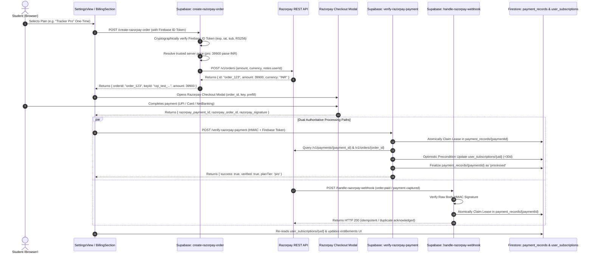

# RAZORPAY PAYMENT ARCHITECTURE & INTEGRATION
**Document ID:** RZP-PAY-ARCH-2026
**Provider:** Razorpay Payments (Test / Live Mode)
**Status:** Implemented & Locally Verified

---

## 1. Architectural Blueprint

Student Tracker uses **Razorpay** exclusively for all paid subscriptions, one-time passes, and cohort sponsorships.

### Core Principles
1. **Server-Controlled Pricing (Zero Client Trust):** The frontend never sends an amount, currency, or Price ID. The backend maps `'pro'` (₹399 / 39900 paise) and `'cohort'` (₹1,499 / 149900 paise) from server-authoritative constants.
2. **Cryptographic Signature Verification:** No payment is credited based on a frontend callback. The backend verifies HMAC-SHA256 signatures using `RAZORPAY_KEY_SECRET` before granting access.
3. **Firestore Single Source of Truth & Permanent Ledger:** Entitlements are read exclusively from Firestore `user_subscriptions/{userId}`. To ensure strict idempotency and cross-endpoint race protection, every processed transaction is permanently stored in `payment_records/{paymentId}` with an atomic processing lock (lease). The client never writes to either collection.
4. **Permanent Offline-First Core:** Timetable, attendance bunk simulator, pomodoro timer, gym logger, and local backups remain permanently free and operational offline.

---

## 2. One-Time Payment Lifecycle & Atomic Concurrency Architecture

---

## 3. Product Decision — One-Time Payments Only

TRAKIFY operates on an exclusive **One-Time Payment Model**:
1. **No Recurring Mandates or Auto-Renewals:** Students purchase passes (e.g. 30-day Pro or Cohort Pass). There are no auto-debits, recurring subscriptions, or surprise renewal charges.
2. **Authoritative Extension Policy:**
   - **Repurchase before expiry:** Duration (+30 days) is appended onto the student's existing unexpired `currentPeriodEnd`. Existing paid access is never reset or lost.
   - **Repurchase after expiry:** Duration (+30 days) starts from the current time.
3. **Automatic Expiry & Downgrade:** When `currentPeriodEnd` passes, paid entitlements stop and the student gracefully reverts to the Free tier.
4. **Idempotency Defense:** Duplicate webhook deliveries or verification calls for the same payment ID are acknowledged safely without extending entitlement multiple times.
5. **Failed Payment Protection:** If a student with an active unexpired pass attempts a new purchase and it fails at the gateway, the failed attempt does not destroy or downgrade their existing active pass.
6. **Retired Functions:** `create-razorpay-subscription` and `cancel-razorpay-subscription` have been deprecated (returning HTTP 410 Gone). Razorpay Plan IDs are not needed.

---

## 4. Legacy Stripe to Razorpay Mapping

| Domain Concept | Legacy Stripe Implementation | Razorpay Replacement Implementation |
|---|---|---|
| **Client Checkout Loader** | Stripe.js / Hosted Stripe Checkout Redirect | Dynamic `https://checkout.razorpay.com/v1/checkout.js` modal |
| **One-Time Checkout Creation** | `create-checkout-session` (`/v1/checkout/sessions`) | `create-razorpay-order` (`/v1/orders`) |
| **Recurring Subscription Creation** | Stripe Checkout with `mode: 'subscription'` | `create-razorpay-subscription` (`/v1/subscriptions`) |
| **Payment Verification** | Client redirected to return URL; relied on webhooks | `verify-razorpay-payment` verified via `HMAC-SHA256(order_id\|payment_id)` |
| **Subscription Mandate Verification** | Stripe SetupIntent / PaymentIntent | `verify-razorpay-payment` verified via `HMAC-SHA256(payment_id\|subscription_id)` |
| **Customer Portal / Cancellation** | `create-customer-portal-session` (Stripe Billing Portal) | Dedicated in-app `cancel-razorpay-subscription` API + Razorpay APIs |
| **Webhook Signature Header** | `stripe-signature` (`t=...,v1=...`) | `x-razorpay-signature` (hex-encoded HMAC-SHA256 of raw body) |
| **Webhook Ingestion Handler** | `handle-payment-webhook` | `handle-razorpay-webhook` |
| **Currencies Supported** | USD ($4.99 / $19.99) | INR / USD (₹399 / ₹1,499 via paise standard 39900 / 149900) |
| **Client Environment Variable** | `VITE_STRIPE_PUBLIC_KEY` | `VITE_RAZORPAY_KEY_ID` (public key for checkout.js modal) |
| **Server Secrets** | `STRIPE_SECRET_KEY`, `STRIPE_WEBHOOK_SECRET` | `RAZORPAY_KEY_ID`, `RAZORPAY_KEY_SECRET`, `RAZORPAY_WEBHOOK_SECRET` |
| **Entitlement Storage** | Firestore `user_subscriptions/{uid}` | Firestore `user_subscriptions/{uid}` (preserved 100%) |

---

## 5. Permanent Idempotency Ledger & Concurrency Guard

1. **Permanent Firestore Ledger (`payment_records/{paymentId}`):**
   - Each payment transaction is permanently keyed by its Razorpay `payment_id` (`pay_...`).
   - The document tracks `status` (`'processing'`, `'processed'`, `'failed'`), `lease_expires_at`, `user_id`, `plan_tier`, `order_id`, and `processed_at`.
   - Security rule: `allow read: if signedIn() && request.auth.uid == resource.data.user_id; allow write: if false;`.
   - Prevents delayed or replayed webhooks for older payments from re-granting access even if the user made newer purchases.

2. **Atomic In-Flight Lease Mechanism:**
   - Both `verify-razorpay-payment` and `handle-razorpay-webhook` invoke `processAuthoritativePayment` in `_shared/firestoreRest.ts`.
   - First caller claims an atomic lease using Firestore document preconditions (`currentDocument.exists == false` or expired lease).
   - A concurrent caller detecting an active lease either backs off (webhook returns 200/503; client retries or backs off) without creating duplicate entitlements.

3. **Optimistic Concurrency on `user_subscriptions/{userId}`:**
   - Writing the entitlement update uses precondition `updateTime == previousReadUpdateTime`.
   - If two different purchases by the same user are processed concurrently, the 412 Precondition Failed triggers an automatic retry (re-reading the latest `currentPeriodEnd` before appending duration), guaranteeing no lost time.
