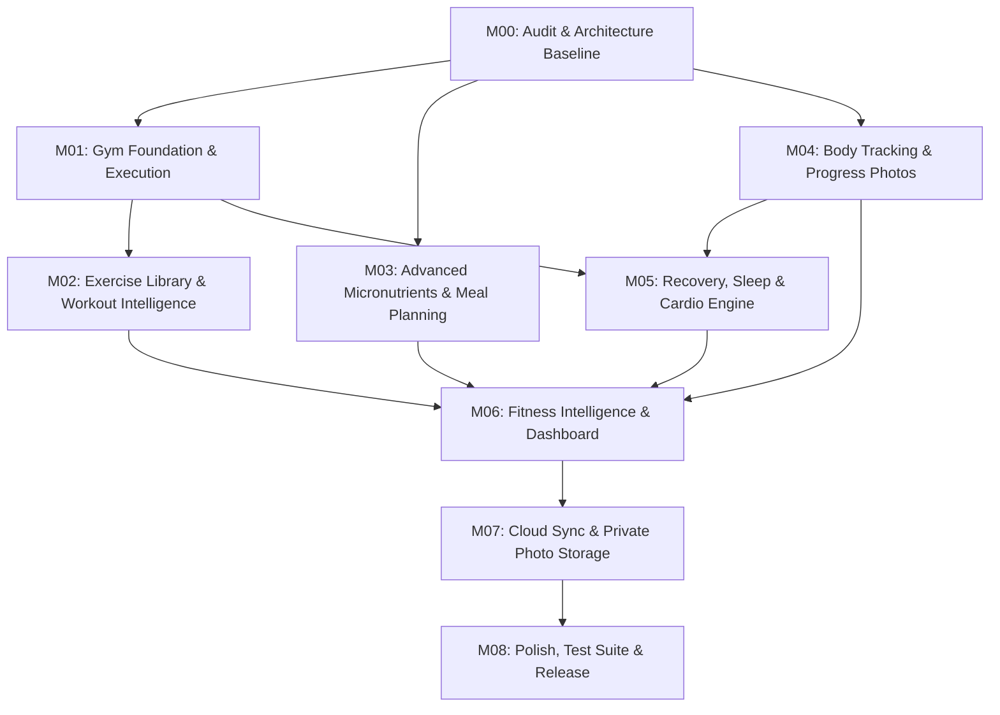

# Student Tracker — Fitness Ecosystem Implementation Guide
**Document ID:** `FITNESS-GUIDE-2026-V1`  
**Parent Specification:** [`FITNESS_MASTER_SPEC.md`](file:///c:/Users/mandy/Downloads/TRACKER/docs/fitness/FITNESS_MASTER_SPEC.md)  
**Target Directory:** `docs/fitness/`  

---

## 1. Overview & Golden Rules

This guide outlines the exact, step-by-step procedure for implementing the Fitness Ecosystem in the Student Tracker project (`C:\Users\mandy\Downloads\TRACKER`). 

### The Golden Rules of Implementation
1. **One Milestone at a Time:** Never attempt to implement multiple milestones in a single turn. Implementing too much simultaneously causes context degradation, token exhaustion, broken tests, and regressions.
2. **Strict Sequential Execution:** Follow the dependency map. Always complete and verify Milestone 00 before Milestone 01, and so forth.
3. **Verify Before Declaring Done:** Every milestone must be proven with `npx tsc --noEmit`, `npm run build`, and dedicated Vitest automated test runs.
4. **Preserve Academic & Existing Code:** The application is a Student Tracker. Never break Timetable, Attendance, ClassSpace, DayOS, Study Planner, or Focus Radio.
5. **Zero External Integrations:** Never install or introduce dependencies on external fitness APIs (Google Fit, Apple Health, external barcode services, external AI APIs). All functionality must remain native, local-first, and application-owned.

---

## 2. Milestone Sequence & Dependency Flow



### Execution Roadmap

| Step | Milestone File | Scope Summary | Prerequisite |
| :---: | :--- | :--- | :--- |
| **1** | [`MILESTONE_00_AUDIT_AND_ARCHITECTURE.md`](file:///c:/Users/mandy/Downloads/TRACKER/docs/fitness/MILESTONE_00_AUDIT_AND_ARCHITECTURE.md) | Consolidate types, backward-compat adapters, storage sanitizers, verify baseline tests. | None |
| **2** | [`MILESTONE_01_GYM_FOUNDATION.md`](file:///c:/Users/mandy/Downloads/TRACKER/docs/fitness/MILESTONE_01_GYM_FOUNDATION.md) | Workout session logger, set types, RPE/RIR, rest timer, volume & PR detection. | M00 |
| **3** | [`MILESTONE_02_EXERCISE_LIBRARY_AND_WORKOUT_INTELLIGENCE.md`](file:///c:/Users/mandy/Downloads/TRACKER/docs/fitness/MILESTONE_02_EXERCISE_LIBRARY_AND_WORKOUT_INTELLIGENCE.md) | 150+ offline exercises, multi-split program creator, 1RM progressive overload, 2D muscle heatmap. | M01 |
| **4** | [`MILESTONE_03_ADVANCED_NUTRITION.md`](file:///c:/Users/mandy/Downloads/TRACKER/docs/fitness/MILESTONE_03_ADVANCED_NUTRITION.md) | 20+ micronutrients, offline barcode engine, weekly meal planner, raw vs cooked, smart recalibration. | M00 |
| **5** | [`MILESTONE_04_BODY_TRACKING_AND_PROGRESS.md`](file:///c:/Users/mandy/Downloads/TRACKER/docs/fitness/MILESTONE_04_BODY_TRACKING_AND_PROGRESS.md) | 10 circumference sites, Navy body fat %, IndexedDB private photo vault with before/after comparator. | M00 |
| **6** | [`MILESTONE_05_RECOVERY_SLEEP_AND_ACTIVITY.md`](file:///c:/Users/mandy/Downloads/TRACKER/docs/fitness/MILESTONE_05_RECOVERY_SLEEP_AND_ACTIVITY.md) | Sleep logs, muscle soreness (DOMS) map, deterministic readiness score, cardio logger (MET calories). | M01, M04 |
| **7** | [`MILESTONE_06_FITNESS_INTELLIGENCE_AND_DASHBOARD.md`](file:///c:/Users/mandy/Downloads/TRACKER/docs/fitness/MILESTONE_06_FITNESS_INTELLIGENCE_AND_DASHBOARD.md) | In-app deterministic fitness insights, timetable-aware workout windows, exam deload, Bento dashboard. | M02–M05 |
| **8** | [`MILESTONE_07_CLOUD_SYNC_AND_DATA_RELIABILITY.md`](file:///c:/Users/mandy/Downloads/TRACKER/docs/fitness/MILESTONE_07_CLOUD_SYNC_AND_DATA_RELIABILITY.md) | Supabase RLS migrations, private `user-fitness-photos` bucket, offline conflict resolution, JSON export/import. | M06 |
| **9** | [`MILESTONE_08_POLISH_TESTING_AND_RELEASE.md`](file:///c:/Users/mandy/Downloads/TRACKER/docs/fitness/MILESTONE_08_POLISH_TESTING_AND_RELEASE.md) | Full regression test suite, WCAG 2.1 AA accessibility, responsive polish, bundle code-splitting. | M07 |

---

## 3. How to Execute a Milestone with Antigravity

When you are ready to implement a milestone, copy and paste the following prompt template into the chat. Replace the milestone placeholder with the specific milestone you want to execute.

### Reusable Implementation Prompt Template

```markdown
# TASK: IMPLEMENT FITNESS ECOSYSTEM MILESTONE [INSERT NUMBER, e.g. MILESTONE 01]

You are working inside my existing Student Tracker web application at `C:\Users\mandy\Downloads\TRACKER`.

Implement the following milestone in full:
`docs/fitness/MILESTONE_[XX]_[NAME].md`

### NON-NEGOTIABLE EXECUTION RULES:
1. Inspect the milestone document and all files listed in "Repository Areas to Inspect" before making changes.
2. Follow all requirements in the milestone document strictly. Do not omit, simplify, or skip any feature.
3. Preserve all existing functionality listed in "Existing Functionality to Preserve".
4. Do not touch or regress academic features (Timetable, Attendance, ClassSpace, DayOS, Study Planner).
5. Zero External Integrations: Do not add external fitness APIs, third-party barcode/nutrition APIs, or external AI APIs.
6. Author the automated Vitest test suite specified in the milestone's "Testing Requirements".
7. Verify your work with:
   - `npx tsc --noEmit`
   - `npm run build`
   - `npx vitest run tests/[test_file_specified_in_milestone]`
8. Do not proceed to subsequent milestones. Report completion of this milestone with test evidence.
```

---

## 4. Context & Token Conservation Best Practices

To prevent context window overflow during implementation:
1. **Do Not Ask for Multiple Milestones Simultaneously:** Implement only the active milestone.
2. **Search-First Instead of Loading Giant Files:** Use targeted grep and symbol searches rather than reading whole 1,000-line files.
3. **Use Focused Test Runs:** Run only the relevant test file during iteration (`npx vitest run tests/myMilestone.test.tsx`) instead of running the entire 45-file suite on every minor change. Run the full suite only at milestone completion.
4. **Use Subagents for Heavy File Exploration:** If a task requires surveying dozens of components, delegate exploration to a research subagent to keep the primary context pristine.

---

## 5. Handling Failed Tests & Regressions

If a test fails during implementation:
1. **Never Delete or Comment Out the Test:** A failing test is an alert that an actual invariant was violated.
2. **Analyze the Regression:**
   - Did an existing test fail because a label was changed (e.g., button accessible name)? Provide an alias or `aria-label` to satisfy both the new and old requirement.
   - Did state serialization fail? Check `storage.ts` sanitizers.
   - Did a calculation fail? Verify mathematical edge cases (e.g., division by zero when distance is 0, or missing neck measurement).
3. **The 3-Strike Debugging Rule:** If an error is not resolved within 3 attempts, halt, review the git diff (`git diff`), isolate the minimal reproduction, and fix the root cause.

---

## 6. Updating Documentation & Tracking Progress

When a milestone is completed:
1. Open the milestone file (e.g., `MILESTONE_01_GYM_FOUNDATION.md`).
2. Mark the items in the **Completion Checklist** as checked (`[x]`).
3. Update [`FITNESS_MASTER_SPEC.md`](file:///c:/Users/mandy/Downloads/TRACKER/docs/fitness/FITNESS_MASTER_SPEC.md) Section 3 ("Existing vs. Planned Functionality Audit") to update that feature's status from *Planned* to *Implemented*.
4. Commit the milestone's code changes cleanly with an atomic commit message (e.g., `feat(fitness): implement Milestone 01 gym foundation and rest timer`).

---
*Ready to begin implementation upon user confirmation.*

