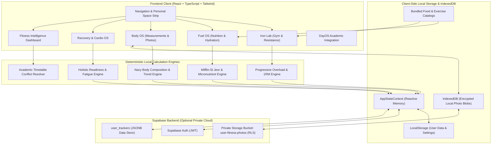
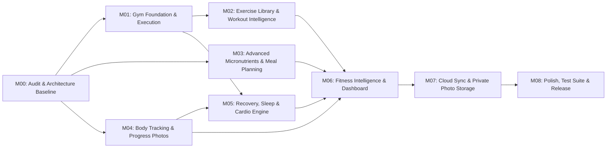

# Student Tracker — Fitness Ecosystem Master Specification
**Document ID:** `FITNESS-SPEC-2026-V1`  
**Status:** Canonical Master Specification & Architecture Baseline  
**Workspace:** `C:\Users\mandy\Downloads\TRACKER`  
**Classification:** Internal Core Architecture Documentation  

---

## 1. Executive Summary & Vision

The Student Tracker Fitness Ecosystem is a fully contained, local-first, privacy-respecting fitness, gym, nutrition, body tracking, and physical recovery architecture designed to seamlessly coexist with the student academic lifecycle (Timetable, Attendance, Study Planner, ClassSpace, and DayOS).

Unlike mainstream fitness apps that force users into subscriptions, sell health metrics to advertisers, or depend on unreliable third-party APIs, this system operates entirely **within the application runtime and the user's private Supabase instance**. 

### The Core Philosophies
1. **Zero External Fitness Integrations:** No reliance on Google Fit, Apple Health, Health Connect, wearable proprietary APIs, commercial barcode APIs, or third-party nutrition databases. Everything is locally stored, locally calculated, and user-owned.
2. **Deterministic Fitness Intelligence:** No unpredictable LLM hallucinations for physical health. All volume calculations, progressive overload cues, recovery estimations, and nutritional calibrations are based on transparent, mathematically sound, explainable sport-science algorithms.
3. **Academic-Fitness Synergy:** Fitness does not compete with studies; it supports cognitive performance. Workouts schedule around lecture timetables, exam seasons prompt deload suggestions, and hydration/meal reminders align with study blocks.
4. **Preservation of Existing State:** The existing Milestone 7 gym workouts, food diary, custom foods, weight logs, and Mifflin–St Jeor calculation engines are preserved and built upon without regressions.

---

## 2. Non-Negotiable Operational Rules

1. **Local-First & Offline-First:** Every feature must function completely offline. The offline food catalogue (780+ items) and exercise database are bundled into the client bundle.
2. **Explicit User Approval:** Algorithmic recalibrations (e.g., target calorie shifts, deload proposals) are strictly *recommendations*. The system must never silently rewrite user targets or schedules without explicit user confirmation.
3. **Informational Non-Medical Scope:** The system calculates physiological estimates (e.g., Mifflin–St Jeor BMR, Harris–Benedict TDEE, Brzycki 1RM, readiness indices). It never presents itself as medical diagnostic software. BMI is explicitly accompanied by clinical disclaimers and pediatric warnings for users under 18.
4. **Zero Feature Degradation:** All 16 feature areas specified in the product scope must be fully documented and implemented without omissions or simplifications.
5. **No Secret Backend Dependencies:** Supabase migrations must use standard PostgreSQL tables and Row-Level Security (RLS) with zero external webhook or edge function requirements for core fitness features.

---

## 3. Existing vs. Planned Functionality Audit

| Domain | Feature Area | Current Status in Repository | Planned Evolution in Ecosystem |
| :--- | :--- | :--- | :--- |
| **Gym** | Workout Split | Fixed PPL text card + single today workout in `GymView.tsx` | Dynamic Multi-Program Manager (PPL, Upper/Lower, Bro, Arnold, Full Body, Home, Custom) |
| **Gym** | Exercise Tracking | Simple list of exercises with reps & weight in `GymSplitWidget.tsx` | Multi-set types (Warmup, Working, Drop, Failure, AMRAP), RPE (1-10), RIR (0-5), supersets, tempo, rest timers |
| **Gym** | Exercise Library | None (exercises typed as arbitrary strings) | 150+ Offline Exercise Library with muscle mappings, cues, equipment, difficulty, and custom exercise creator |
| **Gym** | Progressive Overload | None | Historical 1RM estimation (Brzycki/Epley), volume load tracking, PR badges, transparent progression advice |
| **Nutrition** | Food Diary | Daily log by meal type (`breakfast`, `lunch`, `dinner`, `snacks`, `pre_workout`, `post_workout`) | Retained & expanded: batch logging, meal duplication, nutrient breakdown, raw vs. cooked toggle |
| **Nutrition** | Food Catalogue | 783 items in `src/data/foodCatalogue.ts` (Indian & global foods) | Retained & expanded: full micronutrient profiles (20+ vitamins & minerals), local barcode database |
| **Nutrition** | Macro & Calorie Engine | Mifflin–St Jeor BMR, TDEE multipliers, target calories in `nutritionCalculators.ts` | Retained & expanded: adaptive TDEE rolling averages, smart targets with user confirmation, fiber & water targets |
| **Nutrition** | Meal Planning | None | Weekly meal planning calendar, recipe-based plans, prep reminders, planned vs. actual delta |
| **Body** | Weight Tracking | Daily `WeightLogEntry` (`weightKg`, `date`, `notes`) | Retained & expanded: 7-day rolling weight average, linear trend regression, rate of change |
| **Body** | Circumference Tracking| None | 10 body site measurements (Waist, Chest, Hips, Arms, Thighs, Calves, Neck, Shoulders), WHtR calculation |
| **Body** | Body Composition | Basic BMI calculation in `nutritionCalculators.ts` | Multi-point Navy method body fat %, lean mass, fat mass tracking with measured vs calculated badges |
| **Photos**| Progress Photos | None | Private local/Supabase photo vault, side-by-side comparison, ghost overlay, strict privacy toggles |
| **Recovery**| Sleep & Recovery | None | Sleep duration & quality log, resting HR/HRV manual input, localized muscle soreness heatmap, readiness score |
| **Cardio** | Cardio & Activity | None | Session logger for running, walking, cycling, rowing, swimming, HIIT; manual pace, distance, Zone 2 tracking |
| **Intel** | Fitness Intelligence | Basic 2-week weight trend notice in `evaluateWeightTrend` | In-app deterministic intelligence: volume recovery analysis, academic timetable alignment, exam deload alerts |
| **UI** | Fitness Dashboard | `GymSplitWidget.tsx` and `FitnessSummaryWidget.tsx` | Bento/Grid customizable dashboard, muscle heatmap, streak counter, PR feed, unified DayOS integration |
| **Sync** | Cloud Persistence | `AppStateData` JSON blob in `user_trackers` table | Structured Postgres tables with RLS + offline tombstone sync + private Supabase storage bucket for photos |

---

## 4. System Architecture



---

## 5. Comprehensive Data Model Overview

All fitness data structures reside within `src/types/fitness.ts` and roll up into `AppStateData` in `src/types/index.ts`.

### 5.1 Resistance & Gym Tracking
```typescript
export type SetType = 'warmup' | 'working' | 'drop' | 'failure' | 'amrap';

export interface ExerciseSet {
  id: string;
  setNumber: number;
  type: SetType;
  targetWeightKg?: number;
  targetReps?: number;
  actualWeightKg: number;
  actualReps: number;
  rpe?: number; // Rate of Perceived Exertion: 6.0 to 10.0 (0.5 increments)
  rir?: number; // Reps in Reserve: 0 to 5
  completed: boolean;
  restTimeSeconds?: number;
  notes?: string;
  isPersonalRecord?: boolean;
}

export interface WorkoutExercise {
  id: string;
  exerciseId: string; // Links to ExerciseLibraryItem
  exerciseName: string;
  supersetGroupId?: string; // Grouping ID for supersets, giant sets, or circuits
  order: number;
  isUnilateral?: boolean;
  side?: 'left' | 'right' | 'both';
  sets: ExerciseSet[];
  notes?: string;
  substitutionOriginalExerciseId?: string;
}

export interface WorkoutSession {
  id: string;
  date: string; // YYYY-MM-DD
  startTime?: string; // ISO string or HH:mm
  endTime?: string; // ISO string or HH:mm
  durationMinutes?: number;
  programId?: string;
  templateId?: string;
  splitName: string; // e.g., "Push A (Chest & Triceps Focus)"
  exercises: WorkoutExercise[];
  completed: boolean;
  readinessRating?: number; // 1 to 5
  overallRpe?: number; // 1 to 10
  notes?: string;
  isInterrupted?: boolean;
  isSample?: boolean;
  createdAt: string;
  updatedAt: string;
}
```

### 5.2 Exercise Library & Workout Programs
```typescript
export type MuscleGroup = 
  | 'chest' | 'upper_back' | 'lats' | 'traps' 
  | 'front_delts' | 'side_delts' | 'rear_delts' 
  | 'biceps' | 'triceps' | 'forearms' 
  | 'quads' | 'hamstrings' | 'glutes' | 'calves' 
  | 'abs' | 'obliques' | 'lower_back';

export type EquipmentRequired = 
  | 'barbell' | 'dumbbell' | 'cable' | 'machine' 
  | 'bodyweight' | 'kettlebell' | 'resistance_band' | 'bench' | 'other';

export interface ExerciseLibraryItem {
  id: string;
  name: string;
  category: 'strength' | 'hypertrophy' | 'calisthenics' | 'cardio' | 'mobility';
  primaryMuscle: MuscleGroup;
  secondaryMuscles: MuscleGroup[];
  equipment: EquipmentRequired;
  difficulty: 'beginner' | 'intermediate' | 'advanced';
  instructions: string[];
  coachingCues: string[];
  commonMistakes: string[];
  recommendedRepRange: { min: number; max: number };
  defaultRestSeconds: number;
  isCustom?: boolean;
  isFavorite?: boolean;
  alternativeExerciseIds: string[];
  localIllustrationPath?: string; // Application-bundled SVG/PNG asset
}

export interface WorkoutTemplate {
  id: string;
  name: string;
  splitCategory: 'ppl' | 'upper_lower' | 'full_body' | 'bro_split' | 'arnold' | 'home' | 'custom';
  description?: string;
  exercises: {
    exerciseId: string;
    exerciseName: string;
    targetSets: number;
    recommendedRepRange: { min: number; max: number };
    defaultRestSeconds: number;
  }[];
  createdAt: string;
}

export interface WorkoutProgram {
  id: string;
  name: string;
  splitType: 'ppl' | 'upper_lower' | 'full_body' | 'bro_split' | 'arnold' | 'home' | 'custom';
  description: string;
  daysPerWeek: number;
  schedule: {
    dayOfWeek: 1 | 2 | 3 | 4 | 5 | 6 | 7; // 1=Mon..7=Sun
    isRestDay: boolean;
    templateId?: string;
    customName?: string;
  }[];
  isActive: boolean;
  createdAt: string;
}
```

### 5.3 Advanced Micronutrients, Local Barcodes & Meal Plans
```typescript
export interface MicronutrientProfile {
  fiberGrams?: number;
  sugarGrams?: number;
  saturatedFatGrams?: number;
  monounsaturatedFatGrams?: number;
  polyunsaturatedFatGrams?: number;
  transFatGrams?: number;
  cholesterolMg?: number;
  sodiumMg?: number;
  potassiumMg?: number;
  calciumMg?: number;
  ironMg?: number;
  magnesiumMg?: number;
  zincMg?: number;
  phosphorusMg?: number;
  vitaminAIU?: number;
  vitaminB1Mg?: number;
  vitaminB2Mg?: number;
  vitaminB3Mg?: number;
  vitaminB6Mg?: number;
  vitaminB9Mcg?: number; // Folate
  vitaminB12Mcg?: number;
  vitaminCMg?: number;
  vitaminDIU?: number;
  vitaminEMg?: number;
  vitaminKMcg?: number;
}

export interface LocalBarcodeMapping {
  barcode: string; // EAN-13, EAN-8, UPC-A, UPC-E
  foodId: string;
  brand?: string;
  verified: boolean;
  createdAt: string;
}

export interface MealPlanDay {
  date: string; // YYYY-MM-DD
  targetCalories: number;
  targetProtein: number;
  targetCarbs: number;
  targetFat: number;
  plannedMeals: {
    mealType: MealType;
    recipeId?: string;
    customFoodName?: string;
    plannedQuantity: number;
    plannedUnit: FoodServingUnit;
    calories: number;
    protein: number;
    carbs: number;
    fat: number;
  }[];
  prepReminders?: string[];
}
```

### 5.4 Body Measurements, Body Composition & Progress Photos
```typescript
export interface BodyMeasurementEntry {
  id: string;
  date: string; // YYYY-MM-DD
  weightKg: number;
  waistCm?: number;
  chestCm?: number;
  hipsCm?: number;
  neckCm?: number;
  bicepLeftCm?: number;
  bicepRightCm?: number;
  thighLeftCm?: number;
  thighRightCm?: number;
  calvesCm?: number;
  shouldersCm?: number;
  notes?: string;
  createdAt: string;
}

export interface BodyCompositionEntry {
  id: string;
  date: string;
  method: 'navy_circumference' | 'calipers' | 'bioimpedance_manual' | 'dexa_manual';
  bodyFatPercentage: number;
  leanMassKg: number;
  fatMassKg: number;
  skeletalMuscleMassKg?: number;
  waistToHeightRatio: number;
  isEstimated: boolean;
}

export interface ProgressPhotoEntry {
  id: string;
  date: string; // YYYY-MM-DD
  category: 'front' | 'side' | 'back' | 'custom';
  storagePath: string; // Supabase private bucket path or local IndexedDB key
  thumbnailDataUrl?: string; // Client-side cached compressed thumbnail
  weightKgAtCapture?: number;
  notes?: string;
  isPrivateLocked: boolean; // Requires app PIN/biometric confirmation
  createdAt: string;
}
```

### 5.5 Recovery, Sleep & Cardio Activity
```typescript
export interface SleepRecoveryEntry {
  id: string;
  date: string; // YYYY-MM-DD
  sleepDurationMinutes: number;
  bedTime: string; // HH:mm
  wakeTime: string; // HH:mm
  sleepQualityRating: 1 | 2 | 3 | 4 | 5; // 1=Terrible, 5=Deep & Restorative
  restingHeartRateBpm?: number; // Manually entered
  hrvMs?: number; // Root Mean Square of Successive Differences (rMSSD) if manually entered
  energyLevel: 1 | 2 | 3 | 4 | 5;
  stressLevel: 1 | 2 | 3 | 4 | 5;
  muscleSorenessMap: Record<MuscleGroup, 0 | 1 | 2 | 3>; // 0=None, 3=Severe DOMS
  estimatedReadinessScore: number; // 0 to 100 calculated score
  notes?: string;
  createdAt: string;
}

export type CardioType = 
  | 'walking' | 'running' | 'cycling' | 'treadmill' 
  | 'swimming' | 'rowing' | 'stair_climbing' | 'hiit';

export interface CardioSession {
  id: string;
  date: string;
  cardioType: CardioType;
  durationMinutes: number;
  distanceKm?: number;
  averagePaceMinPerKm?: number;
  averageSpeedKmh?: number;
  elevationGainMeters?: number;
  averageHeartRateBpm?: number;
  zone2Minutes?: number;
  estimatedCaloriesBurned?: number;
  calorieCalculationSource: 'pace_weight_formula' | 'heart_rate_formula' | 'manual_entry';
  notes?: string;
  createdAt: string;
}
```

---

## 6. Milestone Dependency Map



| Milestone ID | Title | Primary Dependencies | Key Deliverable |
| :--- | :--- | :--- | :--- |
| **M00** | Audit & Architecture Baseline | None | Verification of existing M7 code, types consolidation, zero-external policy lock |
| **M01** | Gym Foundation & Execution | M00 | Multi-set types, RPE/RIR, live rest timer, supersets, volume tracking |
| **M02** | Exercise Library & Workout Intelligence | M01 | 150+ offline exercise library, progressive overload algorithms, program creator |
| **M03** | Advanced Micronutrients & Meal Planning | M00 | 20+ micronutrients, offline barcode parser, meal prep calendar, recipe builder |
| **M04** | Body Tracking & Progress Photos | M00 | Circumference tracking, Navy body fat calculation, private photo comparator |
| **M05** | Recovery, Sleep & Cardio Engine | M01, M04 | Sleep logs, muscle soreness heatmap, cardio sessions, Zone 2 tracking |
| **M06** | Fitness Intelligence & Dashboard | M02, M03, M04, M05 | Timetable-aware fitness advice, Bento dashboard widgets, DayOS integration |
| **M07** | Cloud Sync & Private Photo Storage | M06 | Supabase schema migrations, RLS photo bucket, conflict resolution, export/import |
| **M08** | Polish, Test Suite & Release | M07 | 100% test pass guarantee, accessibility audit, edge case hardening |

---

## 7. Data Ownership, Storage, and Privacy Rules

### 7.1 Local-First Tier
* All numerical logs, workout sessions, meals, and measurements are stored synchronously in `localStorage` under `tracker_user_data_${userId}` and validated through `sanitizeEntityArray`.
* The client bundle contains the immutable offline exercise library (`exercises.json`) and offline food catalogue (`foodCatalogue.ts`).
* Progress photos are stored locally using the browser's **IndexedDB** as encrypted binary blobs (`Blob` / `ArrayBuffer`), ensuring that huge base64 strings do not blow up `localStorage` quotas.

### 7.2 Private Cloud Tier (Supabase)
* When the user signs in with Google, fitness state syncs to `public.user_trackers` under strict Row Level Security (`auth.uid() = user_id`).
* Progress photos sync to a **Private Supabase Storage Bucket** named `user-fitness-photos`.
* **Storage Access Policy:**
  ```sql
  -- Storage Bucket RLS
  create policy "Users can only upload their own progress photos"
    on storage.objects for insert
    with check (bucket_id = 'user-fitness-photos' and auth.uid()::text = (storage.foldername(name))[1]);

  create policy "Users can only view their own progress photos"
    on storage.objects for select
    using (bucket_id = 'user-fitness-photos' and auth.uid()::text = (storage.foldername(name))[1]);

  create policy "Users can only delete their own progress photos"
    on storage.objects for delete
    using (bucket_id = 'user-fitness-photos' and auth.uid()::text = (storage.foldername(name))[1]);
  ```
* No public URLs are ever generated for progress photos. All photo access uses short-lived (60-second) signed URLs generated on-the-fly by the authenticated client.

---

## 8. Definition of Done (DoD)

A milestone is strictly considered **DONE** only when:
1. **Zero TypeScript Errors:** `npx tsc --noEmit` exits with status `0`.
2. **Zero Build Failures:** `npm run build` generates production chunks without warnings or syntax errors.
3. **Automated Test Coverage:** A dedicated Vitest regression suite exists in `tests/` covering every newly introduced model, calculation engine, edge case, and UI component with 100% test pass rate.
4. **Existing Feature Protection:** Pre-existing tests (`tests/milestone7.test.tsx`, `tests/nutrition.test.ts`, `tests/personalSpaceDayOSAndTimetableIsolation.test.tsx`) pass with zero regressions.
5. **No Broken Links or Placeholders:** No `TODO`, `FIXME`, or mock external API URLs in the codebase.
6. **Student Tracker Harmony:** The feature does not interfere with academic timetable resolution, attendance tracking, or ClassSpace workspaces.
7. **Empirical Verification:** The functionality is proven through real test assertions, not simulated assertions.

---

## 9. Global Regression Requirements

The Fitness Ecosystem operates within the broader Student Tracker. The following systems are **mission-critical** and must not experience behavioral regressions or state leakage during fitness implementation:

1. **ClassSpace Workspace Isolation:** ClassSpace official timetables and self-attendance must remain completely isolated from personal gym and nutrition logs.
2. **DayOS Timeline Integration:** DayOS displays scheduled workouts and logged meals for the day. Marking a workout or meal complete must strictly toggle that item and never falsely mark academic attendance or generic tasks.
3. **Academic Timetable Conflict Avoidance:** Fitness intelligence suggestions must respect class occurrences and study blocks. If a user has a Chemistry lecture from 10:00 to 11:30, workout suggestions must never schedule across that slot.
4. **Exam Season Deload Mode:** When an academic exam date approaches (within 7 days in `UserProfile.examDate`), fitness intelligence prompts an optional "Study Deload" recommendation (reducing target resistance volume by 30–50% to minimize central nervous system fatigue).
5. **Demo Data Hygiene:** The "Clear Demo Records" utility in `storage.ts` must purge sample workouts or sample meals while keeping genuine user-logged data completely untouched.

---
*Signed and Approved for Implementation Roadmap Execution.*

